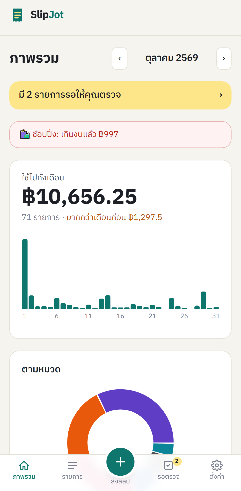
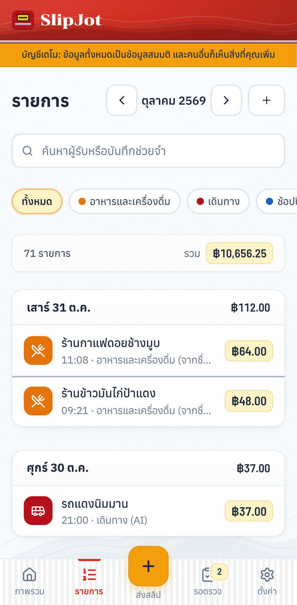

# SlipJot

**ถ่ายสลิป แล้วระบบบันทึกรายจ่ายและจัดหมวดให้.** Send the transfer slips you already have, and SlipJot turns them into a categorised expense log.

**Live:** https://slipjot.vercel.app (press **ลองดูด้วยบัญชีเดโม** on the login page to open a shared demo account with fictional data)

Thais pay almost everything by mobile banking and PromptPay, so the slips end up piling up in the photo album and nobody
tracks where the money went. Expense apps that need every payment typed in get abandoned within a week. SlipJot reads the
slip images (Gemini vision, or local Thai OCR with no API key), learns which payee belongs in which category, and shows
the month at a glance on a phone.

> Status: MVP deployed (all six brief items), Gemini measured. Accuracy numbers below come from **fictional
> synthetic slips**, not real ones. See [Evaluation](#evaluation).

| Landing | Dashboard | Expenses |
|---|---|---|
|  |  |  |

## What it does

1. **Upload slips:** pick several images at once, or share them straight from a banking app. The installed PWA registers
   as a share target, and the service worker hands the files to the upload page.
2. **Read them:** amount, date and time (Buddhist-era years converted), payee, bank, last 4 account digits, reference and
   memo, each with a confidence score. Low-confidence or implausible reads go to a **review queue** with the slip image
   and the doubtful fields highlighted. Nothing is saved silently wrong.
3. **Categorise:** cheap rules first, the LLM last:
   learned payee rule → memo keywords (`ค่าข้าว`, `ค่าหอ`) → payee keywords (Grab, หอพัก, การไฟฟ้า) → Gemini.
   An LLM answer and every user correction become a payee rule, so each payee costs at most one model call, ever.
4. **Duplicates:** the same file is caught by SHA-256 before any OCR or model call. The same slip is caught by its QR
   payload or transaction reference. A re-screenshot is flagged by dHash plus the same amount, and the same
   amount + minute + payee is sent to review rather than dropped.
5. **Dashboard:** month total vs last month, daily bars, category donut, top payees, monthly budgets per category with
   warnings at 80% or when the current pace will overshoot by month end.
6. **CSV export** (UTF-8 BOM so Excel shows Thai, formula injection defused) and installable **PWA**.

## Privacy (PDPA)

- Slip images are processed in memory. An image is stored **only** while its expense waits for review, and it is deleted
  when the user confirms or after 7 days at most. Keeping images is opt-in.
- Only the **last 4 digits** of account numbers are ever stored. The reader drops anything longer.
- Users can export everything as CSV, wipe all data, or delete the account (which cascades to every table).
- Tables have RLS enabled with no policies: only the server's DB connection can read them, and every query goes through
  a data-access layer scoped to the signed-in user.
- No bank connection. Reading a slip's QR code is **not** verification; SlipJot never claims a slip is genuine.
- It shows your own statistics only. No financial advice.

## Security

Slips are financial data, so the app assumes someone will try:

- **XSS:** a strict Content-Security-Policy with a fresh nonce per request and `'strict-dynamic'` (`src/proxy.ts`), so
  only scripts the server rendered can run. React escapes all text, and the slip image route sends `sandbox`.
- **Session theft:** Supabase session cookies are `httpOnly`, `Secure` and `SameSite=Lax`. Nothing in the browser
  uses the Supabase client, so no script can read the token.
- **CSRF and clickjacking:** server actions get Next's origin check, route handlers check Fetch Metadata / Origin, and
  pages cannot be framed (`frame-ancestors 'none'`, `X-Frame-Options: DENY`). HSTS, nosniff, a strict Referrer-Policy
  and a Permissions-Policy are on every response.
- **Brute force and abuse:** Postgres-backed rate limits that hold across every serverless instance (keys HMAC-hashed,
  never raw IPs or emails): sign-in per IP and per email, sign-up per IP, demo login, uploads per user per hour and
  day, a shared daily cap for the demo account, CSV export. New passwords need 10+ characters and are refused when they
  appear in a public breach corpus (Have I Been Pwned range API, k-anonymity: only 5 hash characters leave the server).
- **Hostile files:** the file type comes from the bytes, decoded size is capped against decompression bombs, and every
  image is re-encoded to JPEG before anything reads, stores or sends it, which drops EXIF/GPS and any appended payload.
- **Data exposure:** tables live in a schema the Supabase data API does not expose, with RLS on and no policies, and every
  query goes through the user-scoped data-access layer. Production dependencies: `npm audit --omit=dev` reports 0.
- Tested in `e2e/security.spec.ts` (headers, no CSP violations, cross-site POST refused, cookie not readable from JS),
  `src/lib/security.test.ts`, and against the live site with `E2E_BASE_URL=https://slipjot.vercel.app npx playwright
  test security`.

## Design

A Chiang Mai red songthaew: body red owns whole regions, amounts sit on yellow licence plates, panels are route boards
with an ink title strip and chrome trim, and categories use the real songthaew route colours. Chonburi (Thai
sign-painter lettering) for display, Anuphan for UI, Barlow Semi Condensed for plate digits. Thai text never clips, and
line breaks fall between whole words. The full system is in [DESIGN.md](DESIGN.md).

## Evaluation

### Slip reading (local OCR, no API key)

`npm run eval:slips` reads labelled slips and scores each field per bank layout. **Silent errors** counts slips where a
key field (amount, date/time, payee) was wrong but the slip was *not* sent to review. That's the failure that matters
for an expense log, and it is 0% on both sets.

The synthetic slips are rendered by `scripts/generate-synthetic-slips.mts`: made-up names, accounts and references,
with each bank's field order and date format but no real logos. JPEG quality and scale vary. The parser was tuned on the
dev set. The held-out set uses another seed and was not looked at while tuning.

| reader | set | slips | amount | date+time | payee (exact) | payee (≥85% similar) | payee last4 | reference | all key fields | sent to review | silent errors |
|---|---|---|---|---|---|---|---|---|---|---|---|
| local OCR | dev (5 layouts × 12) | 60 | 100% | 95% | 73% | 100% | 100% | 100% | 95% | 22% | **0%** |
| local OCR | held-out (5 × 8) | 40 | 95% | 95% | 85% | 100% | 98% | 100% | 93% | 15% | **0%** |
| Gemini Flash-Lite | dev | 60 | 100% | 100% | 100% | 100% | 100% | 100% | 100% | 0% | **0%** |
| Gemini Flash-Lite | held-out | 40 | 100% | 100% | 100% | 100% | 100% | 100% | 100% | 0% | **0%** |
| Gemini 3.5 Flash-Lite | held-out | 40 | 100% | 100% | 100% | 100% | 100% | 100% | 100% | 0% | **0%** |

Per-bank tables are in [`eval/results/`](eval/results).

- **Local OCR** takes ~0.75 s per slip on a laptop and costs $0. "Payee exact" is low because tesseract drops Thai vowel
  and tone marks (ภานุวัฒน์ → ภานวัฒน์), so payee keys use the consonant skeleton to keep learned rules matching.
- **Gemini** (`gemini-flash-lite-latest` measured 2026-11-04; `gemini-3.5-flash-lite` re-measured 2026-11-07 at ~3 s per
  slip) uses ~1,200 input + ~330 output tokens per slip, which
  is ≈ $0.0012 per slip at Gemini 2.5 *Flash* prices ($0.30 / $2.50 per 1M). That is an upper bound: Flash-Lite is
  cheaper, and the prices are configurable in `.env`. It takes ~3.4 s per slip. During demand spikes the API returns
  503s and the retries push that to ~16 s. On the free tier, `gemini-flash-latest` is capped at 5 requests/minute and
  was overloaded during testing, so Flash-Lite is the default. The default is now the pinned `gemini-3.5-flash-lite`:
  on 2026-11-07 the `-latest` alias moved to a model that took 20 s+ per slip and pushed uploads past Vercel's 60 s
  limit. Gemini calls run inside a 35 s budget (per-attempt timeouts, retries only while time is left). If Gemini still
  fails, the app falls back to local OCR, which has its own 20 s limit.
- Synthetic slips are clean renders, so Gemini's 100% will not survive real phone screenshots. The OCR → Gemini gap
  is the meaningful part. **Not measured yet:** real slips (`--dir <folder outside the repo>`, which writes only
  aggregate scores).

### Categorisation

`npm run eval:categorize` replays a fictional 90-day stream (381 slips, 31 payees, with OCR-style name noise). Whenever
the result is wrong, a simulated user corrects it once, just like editing a category in the app.

| | no LLM | Gemini Flash-Lite |
|---|---|---|
| categorised by a learned payee rule | 49.9% | 49.9% |
| categorised by memo/payee keywords | 46.7% | 46.7% |
| reached the LLM | 3.4% (13 of 381) | 3.4% (13 calls), 11 of 13 right (85%) |
| LLM share, first week → last month | 23.3% → 0.8% | 23.3% → 0.8% |
| user corrections needed in 90 days | 13 (3.4%) | 2 (0.5%) |

Caveat: the keyword list and the simulated payees were written by the same person, so keyword hit rate and accuracy here
are optimistic. The learning curve (LLM share falling to near zero) is the part that should hold on real data. Without a
key, the "LLM" step gives no answer and the user corrects the slip; with `GEMINI_API_KEY` set, the eval calls Gemini
for real (`-- --model <name>` to pick one).

### Comparing free models locally (FreeLLMAPI)

For development and evals only, the slip reader and categoriser can also talk to
[FreeLLMAPI](https://freellmapi.co), a router over free LLM tiers that runs on this machine at `127.0.0.1:31415`
(OpenAI-compatible). `npm run eval:compare` runs the same evals once per model and writes one table to
`eval/results/compare-*.md`. Free tiers may keep what they receive, so this path is fenced off:

- it only runs on the **synthetic fixture sets**; `--dir` (real slips) is refused;
- the base URL must be a loopback address, and it refuses to run in production;
- in the app it is opt-in (`SLIP_LLM_PROVIDER=freellmapi`), with a red "synthetic slips only" notice on the upload page.

Production on Vercel still uses Gemini directly. See [`eval/results/compare-slips-holdout.md`](eval/results) for the
latest run; free tiers rate-limit hard, so `--rpm` paces the calls and failed slips are counted, not scored.

## Stack

Next.js 16 (App Router, Server Actions, route handlers) · TypeScript · Tailwind CSS 4 · Supabase Auth + Postgres ·
Drizzle ORM · Recharts · Gemini (REST + JSON schema) · tesseract.js + sharp + jsQR · Vitest · Playwright · GitHub Actions.

```
packages/slip-reader/   image → validated JSON. Shared with HarnKan (bill splitter). Gemini path uses web APIs only
  src/parse.ts          rule parser for OCR lines (labels, masked accounts, OCR repairs)
  src/normalize.ts      Thai dates/BE years, amounts, last-4, normalizeThaiName
  src/validate.ts       caps confidence, sets needsReview + Thai issue messages
src/lib/core/           pure logic: categorize, dedup, budget, month (Bangkok time), csv
src/lib/slips.ts        upload pipeline: hash → read → dedup → categorise → save
src/lib/data.ts         data-access layer, every query scoped to the user
src/app/                pages, server actions, /api/slips, /share-target, manifest
public/sw.js            share-target hand-off
eval/                   slip and categorisation evals, fixtures, results
e2e/                    Playwright: signup → upload → dedup → learn → review → export → wipe
```

## Run locally

Needs Node 24+ and Docker Desktop.

```bash
npm install
npx playwright install chromium   # for e2e and for rendering synthetic slips
npm run db:start                  # local Supabase on ports 546xx; prints the keys
cp .env.example .env.local        # paste the publishable and secret keys
npm run db:migrate
npm run seed:demo                 # optional: fictional demo account (see scripts/seed-demo.mts)
npm run dev
```

Set `GEMINI_API_KEY` in `.env.local` to read slips with Gemini and to let the LLM categorise unknown payees. Without it,
slips are read with local Thai OCR (language data downloads once, ~2 MB) and categories come from rules only.

```bash
npm test                 # 90 unit tests
npm run test:e2e         # Playwright, mobile viewport, against the local stack
npm run eval:slips       # add -- --set holdout, -- --provider gemini, or -- --dir <path>
npm run eval:categorize
npm run eval:compare     # several free models via local FreeLLMAPI (synthetic slips only)
npm run lint && npm run typecheck
```

## Account settings and Google sign-in

`/app/settings/account` shows the account (email, sign-in methods), changes or sets the password (the current one is
re-checked with a throwaway session, the new one must pass the same rules as sign-up plus the HIBP check), lists signed-in
devices from `auth.sessions` with per-device sign-out, and holds account deletion. Every password field has a show/hide
button. The shared demo account is read-only here.

Google sign-in goes through Supabase (`/auth/callback` swaps the PKCE code for the session cookie) and stays hidden until
`GOOGLE_AUTH_ENABLED=true`. On the shared Supabase project the Google provider and manual identity linking are already
on (set up for FactFit); SlipJot only needs its own redirect URL in Authentication → URL Configuration:
`https://slipjot.vercel.app/**`. Without it Supabase falls back to the project's Site URL, which is another app.

## Deploy

Vercel (region `sin1`) + hosted Supabase (Singapore). The Supabase free plan allows two active projects, so SlipJot
shares HarnKan's project. Its tables live in their own `slipjot` Postgres schema, with the migration log kept there too.
The two apps share only `auth.users`; HarnKan's tables and auth settings are untouched. Sign-up creates confirmed users
through the admin API, so SlipJot needs no confirmation emails and no redirect URLs on the shared project. The trade-off is
that email addresses are not verified (SlipJot never emails anyone).

```bash
# production values live in .env.vercel-production (gitignored; a name Next.js never loads by itself)
DATABASE_URL=<session pooler :5432 URL> npx drizzle-kit migrate            # schema "slipjot" only
SEED_ALLOW_REMOTE=1 node --env-file=.env.vercel-production scripts/seed-demo.mts
npx vercel env add <NAME> production                                        # Supabase URL/keys, DATABASE_URL, DB_POOL_MAX, GEMINI_*, DEMO_*
npx vercel deploy --prod
E2E_BASE_URL=https://slipjot.vercel.app npx playwright test live            # demo login → dashboard → read one slip → delete it
```

Two things learned on the way:
- **Use Supabase's session pooler (:5432), not the transaction pooler (:6543).** Pages run several queries at once.
  When they outnumber the pool's connections, postgres.js pipelines them, and pipelined queries hang on the transaction
  pooler until the statement times out. `src/db/index.ts` uses a small pool with a short idle timeout instead.
- **tesseract.js needs `outputFileTracingIncludes`** (see `next.config.ts`), because its worker starts from a file path
  that Vercel's tracer cannot follow.

The demo account cannot wipe its data, delete itself or change image retention. Anything a visitor adds stays visible
to the next visitor, which the app says in a banner.

## Roadmap

- [x] Slip reader package (Gemini + local OCR), synthetic eval set, per-bank scores
- [x] Upload, dedup, review queue, image auto-delete
- [x] Hybrid categorisation with learned payee rules, categorisation eval
- [x] Dashboard, budgets, CSV export, PWA share target, e2e tests, CI
- [x] Measure Gemini accuracy and cost per slip (synthetic set), retries + OCR fallback
- [ ] Use it daily for 2–4 weeks; evaluate on a private set of real slips kept outside the repo
- [x] Deploy (Vercel `sin1` + hosted Supabase in Singapore), demo account, live smoke test
